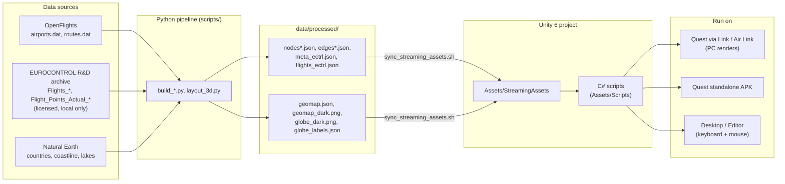
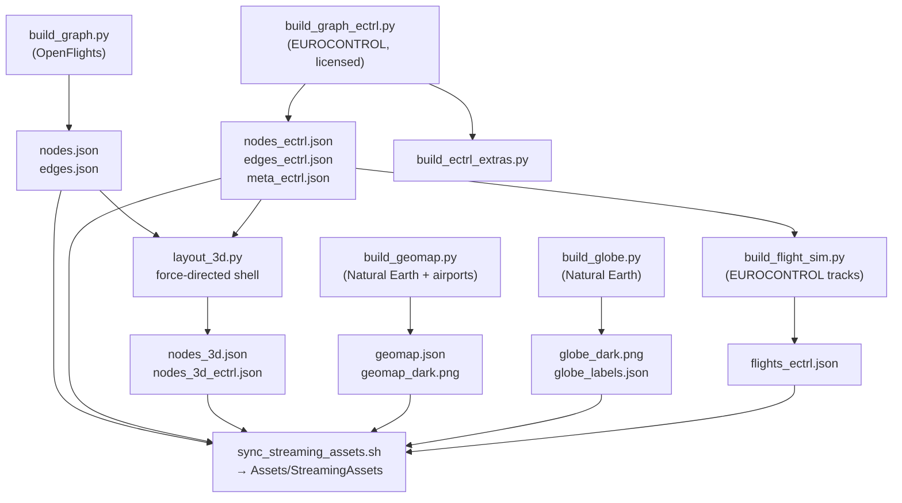
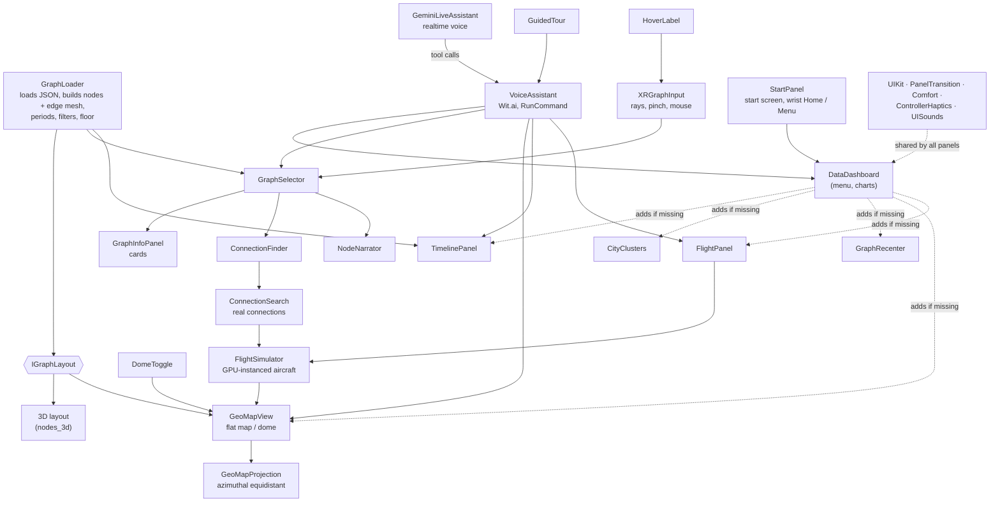
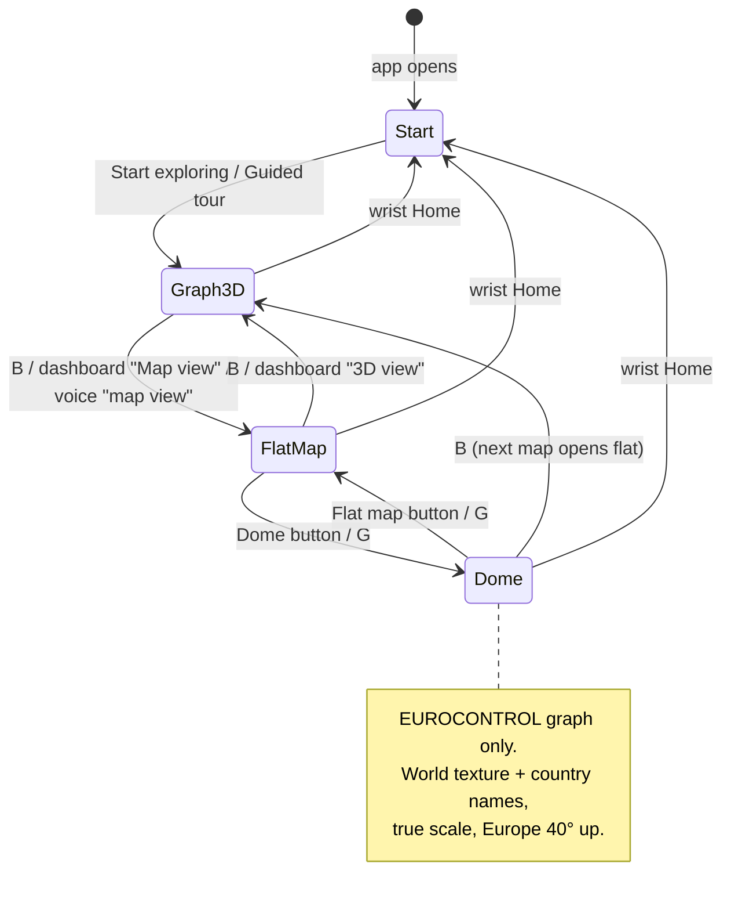
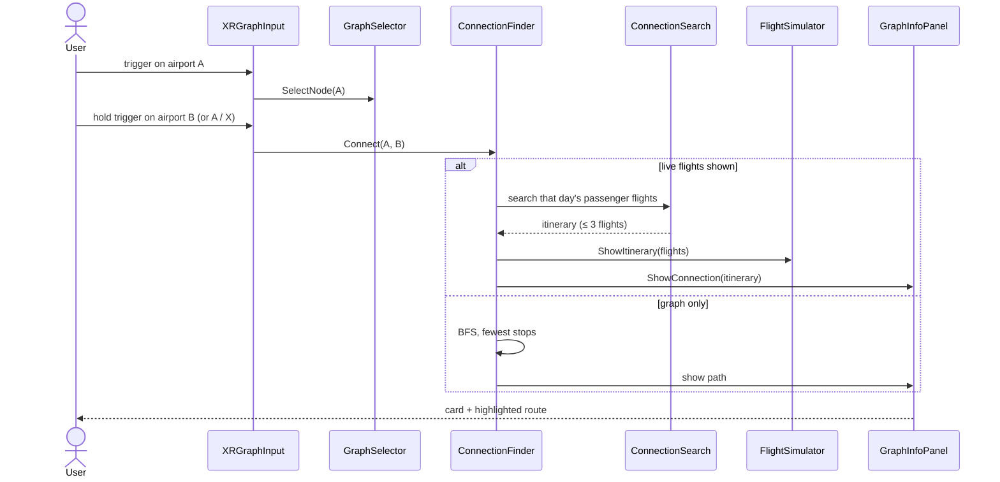
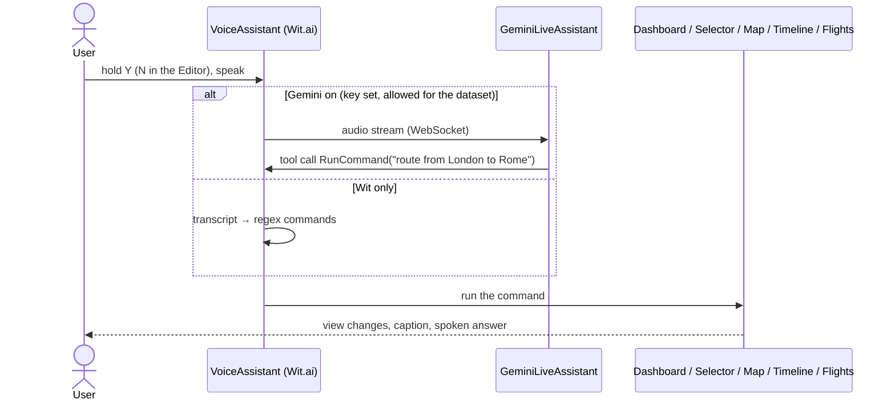

# FlightlyVR

Immersive exploration of airport networks on Meta Quest. A Unity 6 VR app shows a
network of airports and routes in 3D, on a map of Europe and on a dome around you
("you at the centre of the Earth"). It has a timeline over 68 months, a day of live
flights, real connection search and voice control (Wit.ai commands and a Gemini Live
assistant).

This repository holds the **Python data pipeline** and the **Unity C# scripts**. It is
not a full Unity project: there is no `ProjectSettings/` and no scene. The scripts are
copied into a Unity 6 project (see `docs/unity_setup_notes.md`).

> **Data licence.** The EUROCONTROL R&D data is research-licensed. Raw and derived
> EUROCONTROL files (`Flights_*.csv*`, `*_ectrl.json`, `data/processed/eurocontrol/` …)
> are never committed (see `.gitignore`, enforced by CI). OpenFlights (ODbL) and
> Natural Earth (public domain) outputs are in the repo.

---

## Features

| Area | What it does | Main scripts |
|---|---|---|
| Graph | 200 busiest airports, routes as one ribbon mesh, sizes by traffic, regional clusters, city groups | `GraphLoader`, `GraphViewMode`, `CityClusters`, `HubLabels` |
| Layouts | 3D force layout, flat map of Europe, dome (true-scale world around you); spring transitions | `GeoMapView`, `GeoMapProjection`, `DomeToggle` |
| Selection | Ray / pinch / mouse; hover names; info cards; route between two airports; BFS / DFS search | `XRGraphInput`, `GraphSelector`, `HoverLabel`, `GraphInfoPanel`, `ConnectionFinder`, `GraphSearch` |
| Time | Timeline over months; live flights of one day (≈25 k aircraft, real tracks) | `TimelinePanel`, `FlightPanel`, `FlightSimulator` |
| Connections | Real connections over one day's passenger flights (≤ 3 flights, 45 min – 6 h changes) | `ConnectionSearch`, `ConnectionFinder` |
| Voice | Push-to-talk regex commands (Wit.ai), narration, guided tour, realtime Gemini | `VoiceAssistant`, `NodeNarrator`, `GuidedTour`, `GeminiLiveAssistant` |
| UI | Start screen + wrist Home / Menu, dashboard with charts, panels that grow from their source, Reduce motion | `StartPanel`, `DataDashboard`, `UIKit`, `PanelTransition`, `Comfort` |
| Tools | FPS monitor with CSV, mic test | `PerfMonitor`, `MicTest` |

All controls: `docs/CONTROLS.md`.

---

## Architecture

### 1. System overview



### 2. Data pipeline



Tests: `.venv/bin/pytest tests/` (CI runs them and checks that no licensed data is committed).

### 3. Unity runtime components

Most components add themselves at runtime when the scene has a `GraphLoader`, so a
scene needs only the XR rig, the graph object and the dashboard.



### 4. Views and switches



### 5. Route between two airports (with live flights)



### 6. Voice



---

## Repository layout

```
Assets/Scripts/          C# scripts (copy into the Unity project)
  Data/                  JSON data classes
  UI/                    UIKit, StartPanel, ControlsHelp, PanelTransition, Comfort, …
Assets/Shaders/          EdgeRibbon.shader
Assets/StreamingAssets/  sample OpenFlights data (the app reads its data from here)
scripts/                 Python pipeline + sync_streaming_assets.sh
tests/                   pytest for the pipeline
data/processed/          pipeline outputs (licensed files ignored)
docs/                    controls, Unity setup, literature review, research questions
TASKS.md / PROGRESS.md   backlog (B1, B2, …) and log
```

## Quick start

```sh
# 1. Python pipeline
python -m venv .venv && .venv/bin/pip install -r requirements.txt
.venv/bin/python scripts/build_graph.py      # OpenFlights graph
.venv/bin/python scripts/layout_3d.py
.venv/bin/python scripts/build_geomap.py     # map of Europe
.venv/bin/python scripts/build_globe.py      # dome: world texture + country names
.venv/bin/pytest tests/

# 2. Copy outputs into a Unity project
scripts/sync_streaming_assets.sh /path/to/UnityProject
```

3. Unity 6000.3.24f1 (URP), with OpenXR, XR Interaction Toolkit 3.6.1, XR Hands, the
   Input System, Newtonsoft JSON and (optional) the Meta Voice SDK. Copy
   `Assets/Scripts` and `Assets/Shaders` into the project and follow
   `docs/unity_setup_notes.md`.
4. Gemini (optional): put the API key in `gemini_key.txt` in
   `Application.persistentDataPath`, or set `GEMINI_API_KEY`. Never commit it. Gemini
   stays off for the EUROCONTROL scenes unless `allowLicensedData` is ticked.

## Docs

- `docs/CONTROLS.md`: every control (controller, hands, keyboard, voice)
- `docs/unity_setup_notes.md`: scene setup per feature
- `docs/literature_review/`: literature review (LaTeX)
- `TASKS.md`: backlog and status of each item
